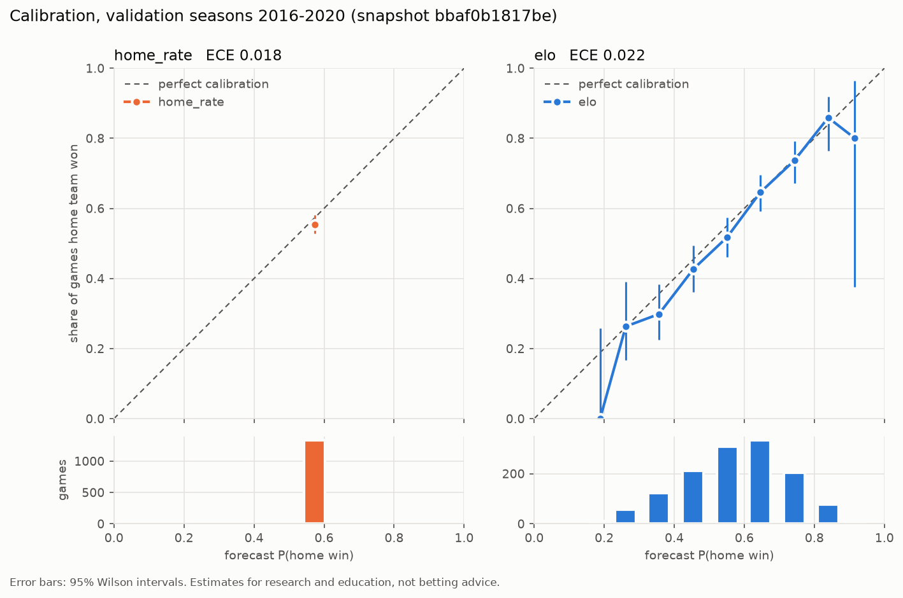

# Multi-Sport AI Forecasting Lab

An educational sports-forecasting simulator. It starts with the NFL.

> **Forecasts are statistical estimates, not facts.** This project is for research and
> learning. It does not place bets, connect to betting accounts, or recommend wagers.

Data: NFL schedule and results from the [nflverse project](https://github.com/nflverse/nflverse-data),
licensed **CC BY 4.0**. See [docs/PLAN.md](docs/PLAN.md) for the sport choice, the data-source
assessment, the architecture, and the roadmap.

## Install (macOS, no admin password needed)

```bash
curl -LsSf https://astral.sh/uv/install.sh | sh      # installs `uv` into ~/.local/bin
source ~/.local/bin/env                               # or open a new terminal
cd forecast_lab
uv venv --python 3.12 .venv                           # private Python 3.12 for this project
uv pip install --python .venv/bin/python -e ".[dev]"  # pandas, numpy, pytest
source .venv/bin/activate                             # do this in each new terminal
```

## Use

```bash
pytest                          # run all tests (no internet needed)
forecast-lab ingest             # download a snapshot (stored only if the data changed)
forecast-lab clean              # validate it; prints data-quality issues
forecast-lab backtest           # replay history; score on VALIDATION seasons 2016-2020
forecast-lab forecast           # file pre-kickoff estimates from ALL models (shows Elo)
forecast-lab scorecard          # score live forecasts once games are final
forecast-lab calibrate          # reliability tables + plot (reports/calibration_validation.png)
forecast-lab records            # what's in the prediction database
forecast-lab simulate           # Monte Carlo the rest of the 2026 season (10,000 runs)
forecast-lab sim-backtest       # check the simulator on 2016-2020 (try --after-week 4 or 12)
forecast-lab tune-elo           # re-run the Elo settings search (train seasons only)
```

`simulate` options: `--season 2024` replays a past season from its snapshot date, `--sims`,
`--seed`, `--model coin_flip` (standings-only baseline), and `--hot` (ratings update inside each run).
Results are saved to `data/simulations/<run_id>.csv`, with a `.json` file holding the settings and data hash.

## Live forecast test (2026 season)

The rules were fixed **before** the first forecast, in [journal/PREREGISTRATION.md](journal/PREREGISTRATION.md).
The frozen model is `elo-1.0+208703b4`.

**Weekly routine: Tuesday (after Monday night) and Thursday morning:**
```bash
forecast-lab ingest && forecast-lab forecast && forecast-lab scorecard
git add forecasts journal data/raw && git commit -m "Week N forecasts" && git push
```
How the test is protected:
- **Kickoff guard:** the database refuses any forecast filed at or after a game's kickoff (UTC, converted from the source's Eastern times).
- **Fingerprinted versions:** each model version includes a fingerprint of its settings and code, so the frozen model can't change silently.
- **Fair baselines:** all three models are filed at the same moments.
- **Public timestamp:** each run is exported to `forecasts/<season>/<run_id>.csv`. Pushing these to GitHub gives an independent timestamp that the forecasts existed before kickoff.

## Milestone 1 results (snapshot `f2bbc6896656`, retrieved 2026-10-13)

| model | games | accuracy | Brier (lower is better) | log loss |
|---|---|---|---|---|
| coin_flip-1.0 | 1,331 | 0.500 | 0.2500 | 0.6931 |
| home_rate-1.0 | 1,331 | 0.557 [0.529, 0.585] | 0.2470 [0.2428, 0.2511] | 0.6871 [0.6786, 0.6953] |

Validation seasons 2016–2020. Brackets are 95% bootstrap intervals. Six ties were excluded and counted.

**Interpretation:** "home team wins about 57%" is real but weak information. It *lost* to the
coin flip in 2019 and 2020, when home teams won only 52% and 50% of games (2020 was played in
mostly empty stadiums). A model that only looks at the past assumes the future looks the same.
Team strength (Elo, Milestone 2) is the next step.

## Milestone 2 results: Elo ratings

Settings were chosen by `tune-elo` on train seasons 2002–2015 only: K = 20, home field = 55, between-season reversion = 1/2.
The top settings were within 0.0005 Brier of each other, so the exact choice barely matters.

| model (validation 2016–2020, 1,331 games) | accuracy | Brier | log loss |
|---|---|---|---|
| coin_flip-1.0 | 0.500 | 0.2500 | 0.6931 |
| home_rate-1.0 | 0.557 [0.529, 0.585] | 0.2470 [0.2428, 0.2511] | 0.6871 [0.6786, 0.6953] |
| **elo-1.0** | **0.644 [0.619, 0.669]** | **0.2195 [0.2120, 0.2275]** | **0.6289 [0.6123, 0.6464]** |

Elo beat home_rate in every validation season, including 2020, because it knows *which* teams are good.

### Calibration (validation 2016–2020)



All nine of Elo's probability bins have 95% intervals that include the diagonal; it is
well calibrated. From 30% to 60%, home teams won slightly less often than Elo predicted, which fits
shrinking home advantage, though it is within noise. home_rate has the lower ECE (0.018 vs 0.022)
only because it says 57–58% for every game: it's calibrated but uninformative. Read the plot and
the Brier score together, never ECE alone.

## Milestone 3: Season simulator

Plays out the remaining regular season 10,000 times using Elo game probabilities, then reports each
team's distribution of final wins and its division, playoff, and #1-seed odds.
It is checked against 2016–2020, re-running the simulator after week 8 of each season using only what was known then:

| sim model | team-seasons | playoff Brier [95%] | wins MAE | actual wins inside 10–90% range |
|---|---|---|---|---|
| coin_flip (standings only) | 160 | 0.119 [0.093, 0.147] | 1.65 | 74% |
| **elo** | 160 | **0.112** [0.082, 0.146] | **1.39** | **81%** (target 80%) |

Elo's improvement is consistent at weeks 4, 8, and 12, but the intervals overlap. 160 team-seasons is
a small sample, and teams in one season aren't independent. Read it as "better, by a modest amount".

**Known limitations** (printed with every run): ties in the standings are broken at random, not by
NFL tiebreaker rules; game ties aren't simulated; no injury, trade, or rest information is used; the
uncertainty in the Elo settings themselves isn't included; and the 7-team playoff format is assumed
unchanged for 2026.

## Milestone 1 acceptance tests

| ID | Requirement | Test file |
|---|---|---|
| AT-1 | Raw data is stored byte for byte with source URL, license, UTC time, and SHA-256. Identical downloads aren't duplicated. Old snapshots stay loadable. Edits to raw files are detected. | `tests/test_ingest.py` |
| AT-2 | Bad rows (duplicate ID, unknown team, same team twice, negative or partial score, bad date, location, or type, score on a future date) are **excluded and logged**. Past games missing scores are **flagged, not filled in**. Relocated teams get stable franchise IDs. Betting columns are dropped. Cleaning one snapshot twice gives identical bytes. | `tests/test_clean.py` |
| AT-3 | Every prediction is a valid probability distribution with features and warnings recorded. **Changing future results never changes past predictions.** Same-day games don't see each other. Neutral sites get no home edge. | `tests/test_baseline.py` |
| AT-4 | Brier, log loss, and accuracy match hand-computed values. Bootstrap intervals are reproducible. Ties and unresolved games are counted. **Test seasons 2021–2025 refuse to be scored without `--unlock-test`.** | `tests/test_metrics.py` |
| AT-6 | Elo: correct probability formula; ratings are zero-sum (average stays 1500); winners gain; bigger margins count more but favorites are damped; ratings revert between seasons; **no look-ahead**; neutral sites get no home edge. | `tests/test_elo.py` |
| AT-7 | Simulator: playoff, division, and #1-seed odds sum to exactly 14, 8, and 2; total wins are conserved; same seed gives the same result; **results after the cutoff are ignored even when present in the data**; a finished season has zero uncertainty; locked test seasons are refused. | `tests/test_simulate.py` |
| AT-8 | Live scoring: only pre-kickoff forecasts count; the latest pre-kickoff forecast per game is scored; ties and pending games are counted, not scored; forecasts filed even one minute after kickoff are refused; old databases migrate without losing rows; settings changes change the model fingerprint. | `tests/test_scorecard.py`, `tests/test_store.py`, `tests/test_baseline.py` |
| AT-9 | Calibration: Wilson intervals match known values and stay in [0, 1]; perfectly calibrated forecasts give ECE 0; overconfidence is detected; ties aren't scored; test seasons stay locked; the plot is written. | `tests/test_calibration.py` |
| AT-5 | Backtest and prospective records are separate. A "before the game" forecast is refused for games already played. Re-runs never overwrite. Outcomes are recorded later. **The database refuses edits to stored forecasts.** | `tests/test_store.py` |

## What each file does

| File | Purpose |
|---|---|
| `config.py` | Folder paths, plus the train (1999–2015), validation (2016–2020), and locked test (2021–2025) seasons |
| `sources.py` | Each data source's URL, license, attribution, and the date it was checked |
| `ingest.py` | Downloads, hashes, and saves a read-only raw snapshot plus its JSON manifest |
| `teams.py` | Team codes → franchise IDs (OAK→LV, SD→LAC, STL→LA) |
| `clean.py` | Validation rules: errors exclude a row, warnings flag it. Writes `games.csv`, `issues.csv`, and `manifest.json`. |
| `baseline.py` | `coin_flip` and `home_rate` (league home-win rate before each date, shrunk toward 50% by a Beta(10,10) prior) |
| `metrics.py` | Accuracy, Brier, log loss, bootstrap intervals, the test-set lock |
| `elo.py` | Elo ratings: walk-forward predictions, margin multiplier, season reversion, settings search |
| `models.py` | Registry of all game models (coin_flip, home_rate, elo) |
| `nfl_structure.py` | Divisions and conferences (checked against the data's `div_game` flag, 2002–2026) and playoff format |
| `simulate.py` | Monte Carlo season simulator, its backtest, and the summary scores |
| `calibration.py` | Reliability tables, Wilson intervals, ECE, calibration plot |
| `scorecard.py` | Scores live forecasts by the pre-registered rule; calibration table |
| `store.py` | SQLite prediction log (append-only; backtest vs prospective) |
| `cli.py` | The `forecast-lab` commands. Each run is appended to `journal/experiments.jsonl`. |

**Dependencies:** `pandas` and `numpy` (tables and math), `matplotlib` (plots), `pytest` (tests). `sqlite3`, `urllib`,
`hashlib`, and `json` are built into Python. scikit-learn, DuckDB, and Streamlit
arrive in later milestones.

**Back up `data/raw/`.** nflverse updates `games.csv` in place, so an old version can only be
re-created from your own snapshot. Git tracks each snapshot's manifest (hash, time, URL) but not
the 2 MB CSV itself, so copy `data/raw/` to a backup drive or cloud folder now and then.
`data/lab.sqlite` holds your forecast records; back it up too.

## Troubleshooting

| Symptom | Fix |
|---|---|
| `xcode-select: note: No developer tools were found` | That's macOS's placeholder `python3`. Use the uv steps above. Xcode's Python (3.9) is too old anyway. |
| `forecast-lab: command not found` | Run `source .venv/bin/activate` in this terminal (or call `.venv/bin/forecast-lab`). |
| `No snapshot of 'nflverse_schedules'` | Run `forecast-lab ingest` first. |
| `urllib.error.URLError` during ingest | Check your internet connection, or whether GitHub is down. Your existing snapshots still work offline. |
| `SnapshotIntegrityError` | A raw file was edited. Don't fix it by hand; run `ingest` again. |
| `The test seasons are locked` | Working as intended. Compare models on validation. Unlock once, at the end. |
| `ProspectiveForecastError` | You tried to file a pre-game forecast for a game that already happened. That's what `backtest` is for. |
| `SchemaError: missing required columns` | The source changed its format. Check its docs, then update `clean.py`. |
